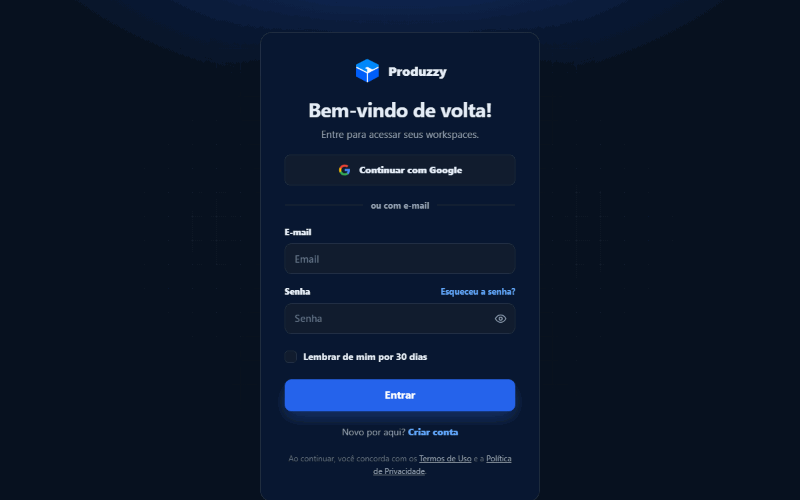
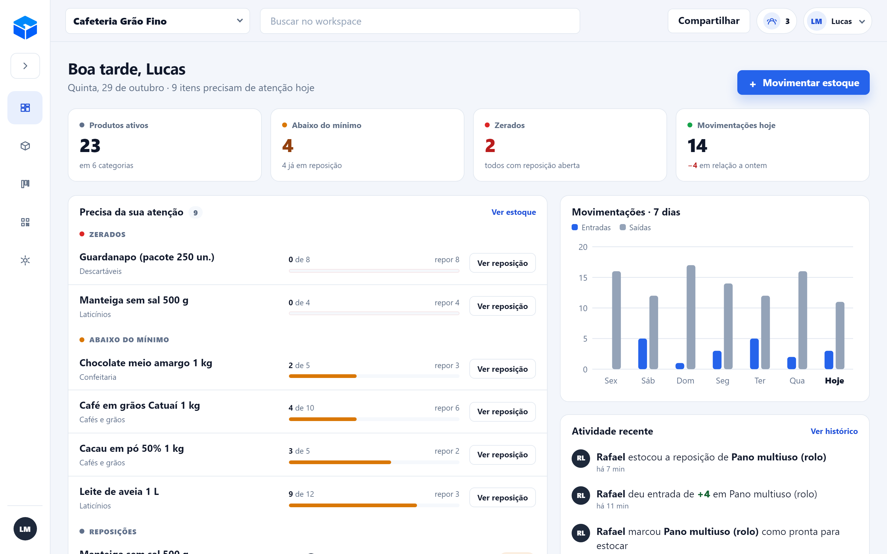
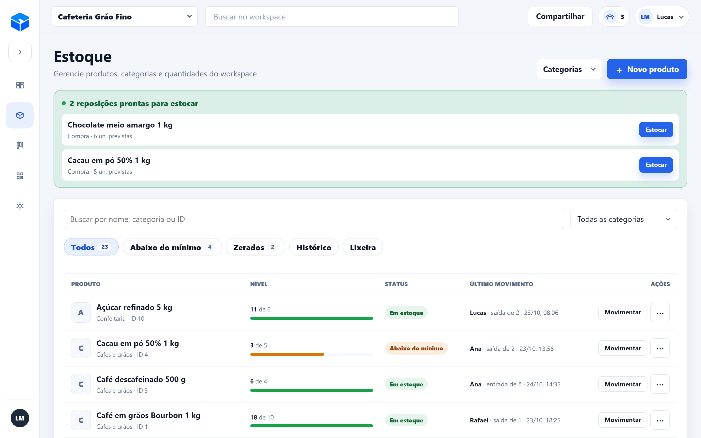
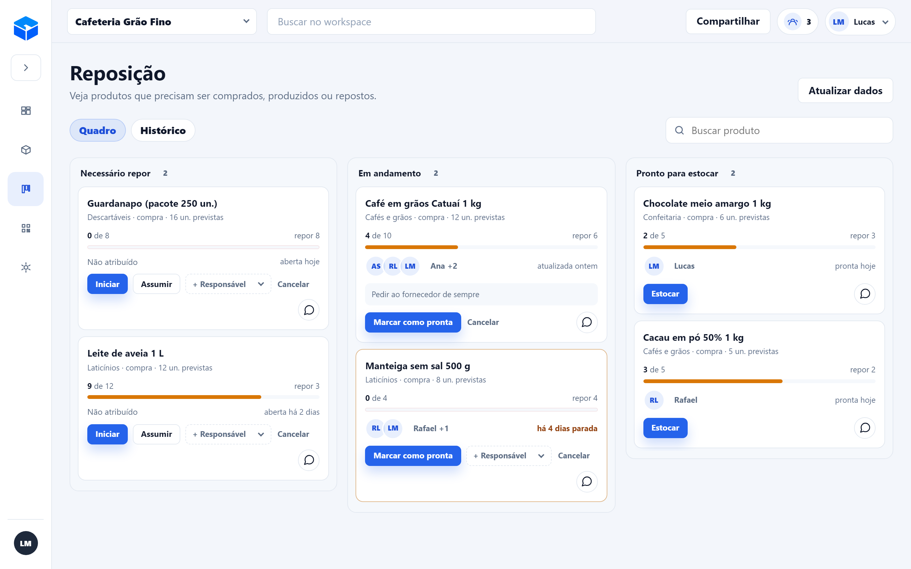
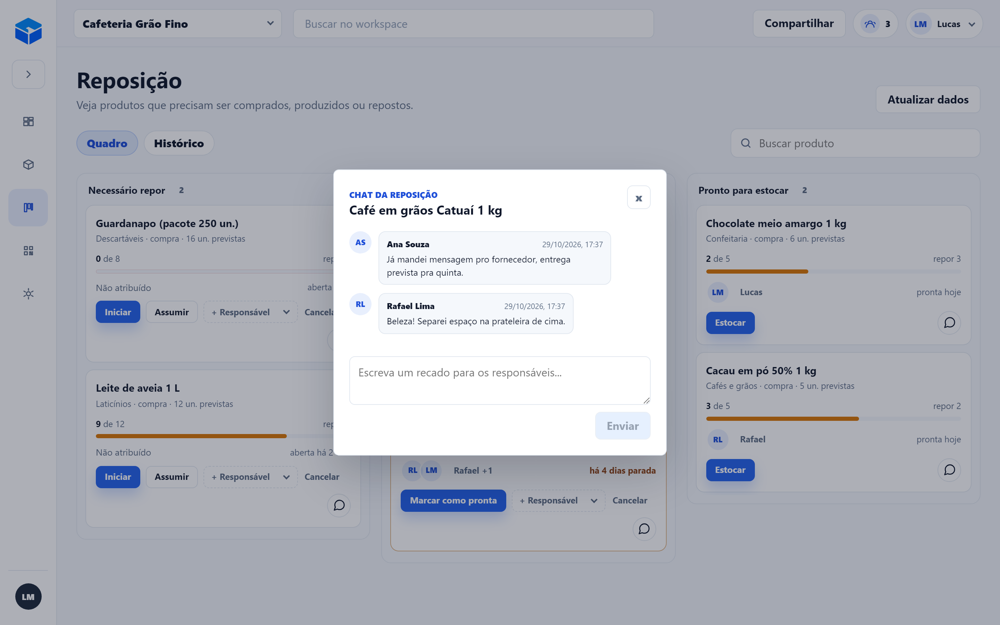
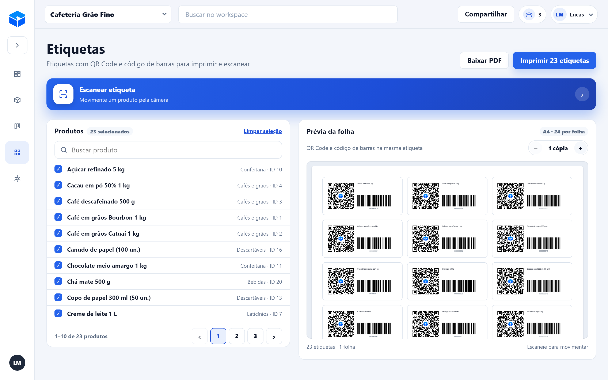
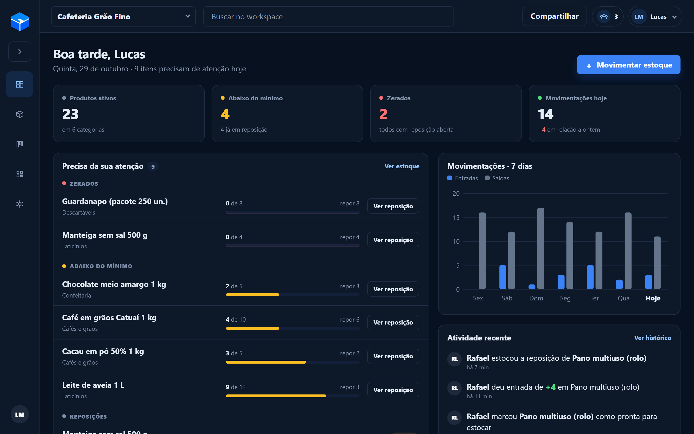
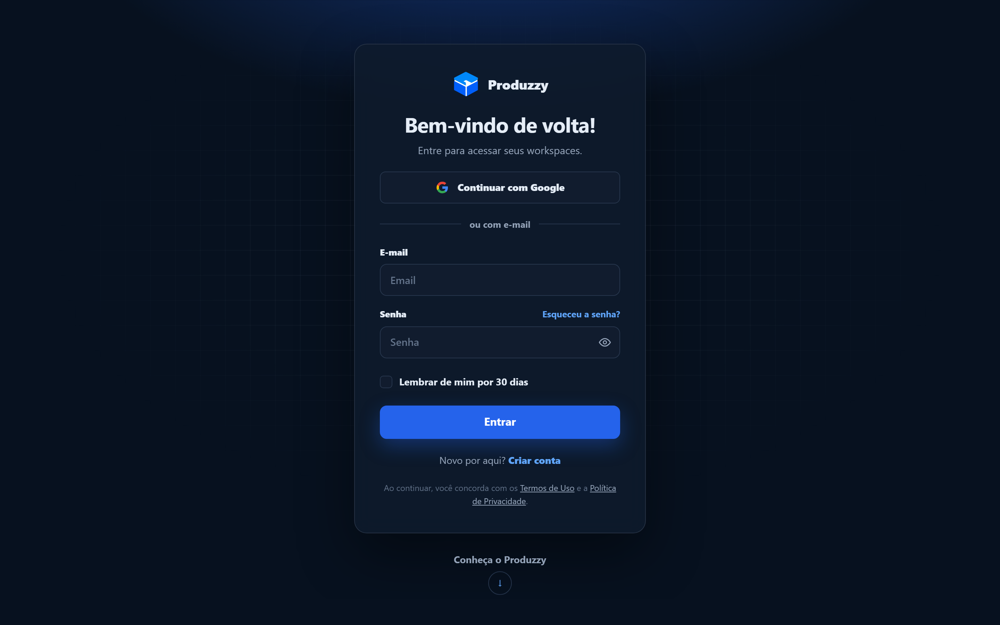
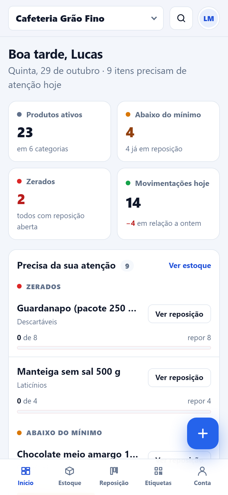
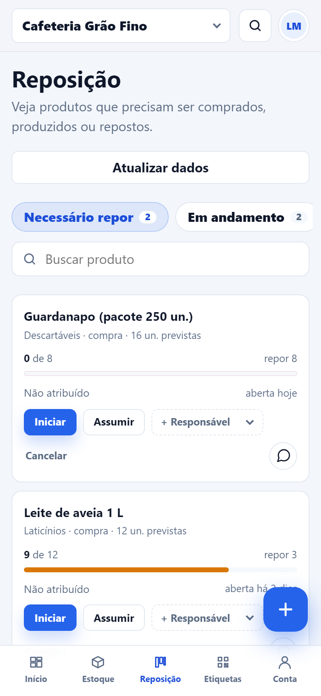

# Produzzy — estoque e reposição em equipe

SaaS full-stack para organizar produtos, registrar entradas e saídas e acompanhar a reposição do que está acabando, com a equipe inteira trabalhando no mesmo workspace. Feito com **React**, **FastAPI** e **PostgreSQL**, com deploy no Render e banco no Neon.

**🔗 Acesse: [produzzy.onrender.com](https://produzzy.onrender.com)**

<p align="center">
  
</p>

## Telas

| Dashboard | Estoque |
| --- | --- |
|  |  |

| Quadro de reposição | Chat da reposição |
| --- | --- |
|  |  |

| Etiquetas | Tema escuro |
| --- | --- |
|  |  |

| Login | Celular |
| --- | --- |
|  |   |

## Funcionalidades

- **Dashboard:** produtos ativos, itens abaixo do mínimo, zerados e movimentações do dia, com uma lista do que precisa de atenção, reposições paradas há 3 dias ou mais, gráfico de entradas e saídas dos últimos 7 dias e feed de atividade da equipe.
- **Estoque:** produtos por categoria, com foto opcional, barra de nível, status calculado pelo estoque mínimo e último movimento ("Ana · saída de 2 · 23/10"). Tem filtros, busca, paginação, histórico e lixeira com restauração.
- **Movimentações:** entradas, saídas e ajustes com motivo, registrando quem fez, a quantidade antes e depois e o horário.
- **Reposição:** quadro com as etapas *Necessário repor*, *Em andamento* e *Pronto para estocar*. Cada card mostra o responsável, há quanto tempo está aberto e a próxima ação. Há um chat por pedido para a passagem de turno. No celular, uma etapa por vez.
- **Etiquetas:** QR Code (com o logo no centro) e código de barras Code 128 na mesma etiqueta, com prévia da folha A4 gerada pela API e download em PDF ou impressão.
- **Leitor pela câmera:** escanear a etiqueta abre direto a movimentação daquele produto.
- **Workspaces:** vários por conta, com dados isolados. Convites por e-mail ou por link, com papéis (dono, admin, funcionário, leitor) e cargos livres ("Gerente", "Estoquista").
- **Conta:** login com e-mail e senha ou com Google, "lembrar de mim" por 30 dias, recuperação de senha por e-mail, e-mail de recuperação reserva e foto de perfil com recorte.
- **LGPD:** Termos de Uso, Política de Privacidade, exportação dos dados pessoais em PDF e exclusão da conta.
- **Interface:** tema claro e escuro, layout próprio para celular (barra inferior e botão "+"), contraste AA, foco visível no teclado e respeito à opção "reduzir movimento".

## Decisões técnicas

- **Workspace em todas as rotas.** Toda rota de dados fica sob `/workspaces/{id}/...` e passa pela checagem de papel antes de qualquer leitura ou escrita, então um membro nunca enxerga outro workspace.
- **Estoque nunca fica negativo.** A regra é validada no código e também no banco, com um `CHECK (quantity >= 0)`. Movimentações simultâneas no mesmo produto travam a linha com `SELECT ... FOR UPDATE`, e há um teste de concorrência cobrindo esse caso.
- **Soft delete com nomes únicos.** Produtos e categorias excluídos vão para a lixeira, e um índice único parcial (`WHERE is_active`) impede nomes repetidos só entre os ativos. Assim, dá para recriar um item com o mesmo nome do que foi excluído.
- **Uma reposição ativa por produto.** Também é garantido por índice único, não só pela interface.
- **Trocar a senha encerra as outras sessões.** O JWT carrega uma impressão digital do hash da senha. Quando a senha muda, os tokens antigos deixam de valer, e o link de redefinição só funciona uma vez.
- **Rate limit com o IP real.** O limite de tentativas no login, no cadastro, em "esqueci a senha" e no aceite de convite usa o último IP do `X-Forwarded-For`, que é o único confiável atrás do proxy do Render.
- **Retenção preguiçosa.** Reposições canceladas somem depois de 7 dias, e o chat das finalizadas depois de 30. A limpeza roda no máximo uma vez por dia, quando o quadro é aberto, sem precisar de cron.
- **Trilha de auditoria.** Cada ação relevante gera um registro com metadados em JSONB, que alimenta o feed de atividade do dashboard.
- **Camadas finas.** Os routers só tratam HTTP, as regras ficam em `crud/` e as integrações (e-mail, Google, Cloudinary, QR Code) em `services/`.

## Tecnologias

| Frontend | Backend | Infra |
| --- | --- | --- |
| React 19 | Python e FastAPI | PostgreSQL (Neon) |
| Vite e React Router | SQLAlchemy e Alembic | Render (API e site estático) |
| TanStack Query | Pydantic | GitHub Actions (CI) |
| ZXing (leitor de QR e código de barras) | JWT (python-jose) e bcrypt | Cloudinary (fotos) |
| jsPDF | Pillow, qrcode e python-barcode | SMTP (e-mails) |
| CSS puro (sem framework) | Pytest | |

## Como rodar

Requisitos: **Python 3**, **Node.js** e **PostgreSQL**.

```bash
git clone https://github.com/LBMedeiros/Produzzy.git
cd Produzzy
```

**Backend** (em um terminal):

```bash
cd backend
python -m venv venv
source venv/bin/activate        # no Windows: venv\Scripts\activate
pip install -r requirements.txt
cp .env.example .env            # ajuste a DATABASE_URL e o PRODUZZY_SECRET_KEY
alembic upgrade head
uvicorn app.main:app --reload
```

**Frontend** (em outro terminal):

```bash
cd frontend
npm install
cp .env.example .env.local
npm run dev
```

Abra **http://localhost:5173** e crie uma conta. A API fica em `http://127.0.0.1:8000`, com a documentação interativa em `/docs`.

| Comando | Onde | O que faz |
| --- | --- | --- |
| `uvicorn app.main:app --reload` | `backend/` | Sobe a API com recarga automática |
| `alembic upgrade head` | `backend/` | Aplica as migrations |
| `python -m pytest` | `backend/` | Roda os testes (exige `DATABASE_URL_TEST`) |
| `npm run dev` | `frontend/` | Sobe o frontend em `localhost:5173` |
| `npm run build` | `frontend/` | Gera o build de produção |
| `npm run lint` | `frontend/` | Verifica o código com ESLint |

## Variáveis de ambiente

`backend/.env` (lista completa em [`backend/.env.example`](backend/.env.example)):

| Variável | Obrigatória | Descrição |
| --- | --- | --- |
| `DATABASE_URL` | Sim | Conexão com o PostgreSQL |
| `PRODUZZY_SECRET_KEY` | Sim | Segredo que assina os tokens (longo e aleatório em produção) |
| `PRODUZZY_ALLOWED_ORIGINS` | Não | Endereços do frontend liberados no CORS, separados por vírgula |
| `DATABASE_URL_TEST` | Para testes | Banco separado para a suíte de testes |
| `PRODUZZY_GOOGLE_CLIENT_ID` / `_SECRET` | Não | Login com Google |
| `PRODUZZY_CLOUDINARY_*` | Não | Upload de foto de perfil e de produto (as três juntas) |
| `PRODUZZY_SMTP_*` | Não | Envio dos e-mails de recuperação de senha |

`frontend/.env.local`:

| Variável | Descrição |
| --- | --- |
| `VITE_API_URL` | Endereço da API (padrão `http://127.0.0.1:8000`) |
| `VITE_GOOGLE_CLIENT_ID` | Client ID do Google, se o login com Google estiver ativo |

## API

Rotas autenticadas exigem `Authorization: Bearer <token>`. A referência completa fica no Swagger, em `/docs`.

| Grupo | Rotas principais |
| --- | --- |
| Autenticação | `POST /auth/register`, `POST /auth/login`, `POST /auth/google`, `POST /auth/forgot-password`, `GET /auth/me` |
| Workspaces | `GET/POST /workspaces`, membros, convites (`/invites`, `/invite-links`) |
| Produtos | `GET/POST /workspaces/{id}/products`, `/low-stock`, `/{produto}/restore`, `/{produto}/image` |
| Movimentações | `POST /workspaces/{id}/products/{produto}/stock`, `GET /workspaces/{id}/stock-movements` |
| Reposição | `GET/POST /workspaces/{id}/replenishments`, responsáveis, `/{pedido}/messages` |
| Etiquetas | QR Code, código de barras e folha A4 por produto |
| Painel | `GET /workspaces/{id}/dashboard`, busca global e audit log |
| Saúde | `GET /health` e `GET /ready` |

## Qualidade e deploy

- **155 testes de integração** com Pytest, rodando contra um PostgreSQL de verdade. Cobrem permissões, isolamento entre workspaces, concorrência no estoque, convites, reposição e recuperação de senha.
- **CI no GitHub Actions** em todo pull request: lint e build do frontend e a suíte do backend com PostgreSQL 16.
- **Em produção** em [produzzy.onrender.com](https://produzzy.onrender.com), com deploy no Render pelo Blueprint [`render.yaml`](render.yaml). As migrations rodam antes de cada deploy, e o banco é um PostgreSQL gerenciado no Neon. O passo a passo completo está em [`DEPLOY.md`](DEPLOY.md).

## Estrutura

```
├── backend/
│   ├── app/
│   │   ├── routers/         # Camada HTTP: auth, produtos, estoque, reposição, workspaces...
│   │   ├── crud/            # Regras de negócio
│   │   ├── services/        # Segurança, Google, e-mail, Cloudinary, QR Code, rate limit
│   │   ├── models.py        # Tabelas (SQLAlchemy)
│   │   └── schemas.py       # Validação de entrada e saída (Pydantic)
│   ├── alembic/             # Migrations
│   └── tests/               # Testes de integração
├── frontend/
│   └── src/
│       ├── pages/           # Dashboard, Estoque, Reposição, Etiquetas, Configurações, login...
│       ├── components/      # Layout, UI, reposição, etiquetas, auth
│       ├── contexts/        # Sessão, workspace ativo e tema
│       ├── services/        # Chamadas à API por domínio
│       └── lib/             # Cliente HTTP, formatação, senha, exportação em PDF
├── docs/                    # Spec do redesign e imagens deste README
├── render.yaml              # Blueprint do Render
└── DEPLOY.md                # Checklist de deploy
```

## Próximos passos

- QA ponta a ponta de todos os fluxos
- Ampliar a cobertura de testes automatizados
- Monitoramento e backups em produção

## Autor

Feito por **Lucas Medeiros** · [GitHub](https://github.com/LBMedeiros) · [LinkedIn](https://linkedin.com/in/lbmedeiros)
